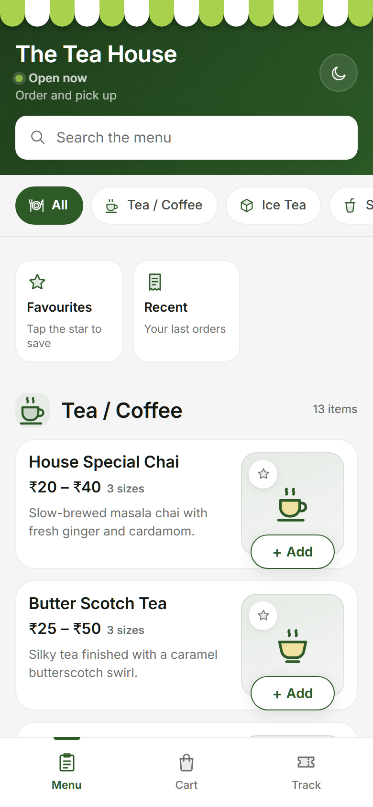
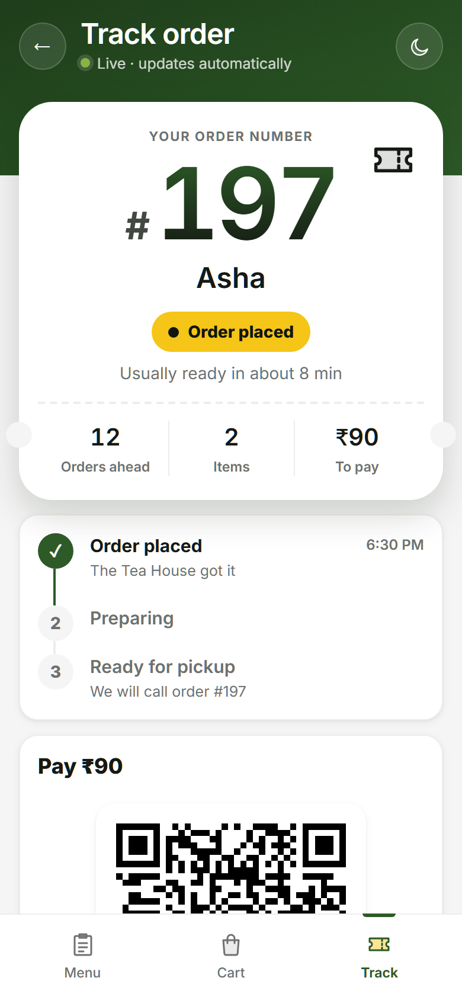
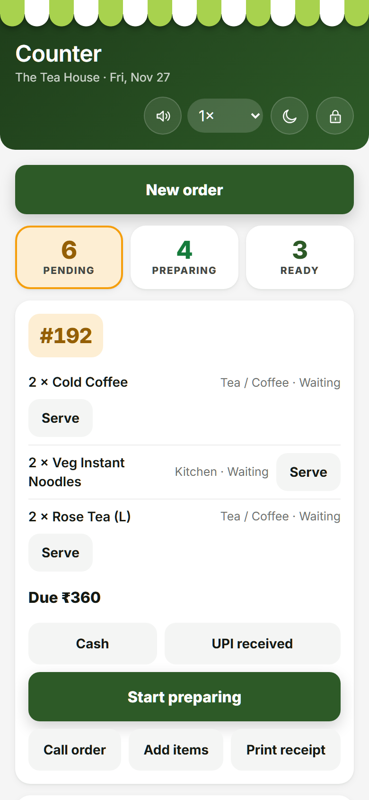
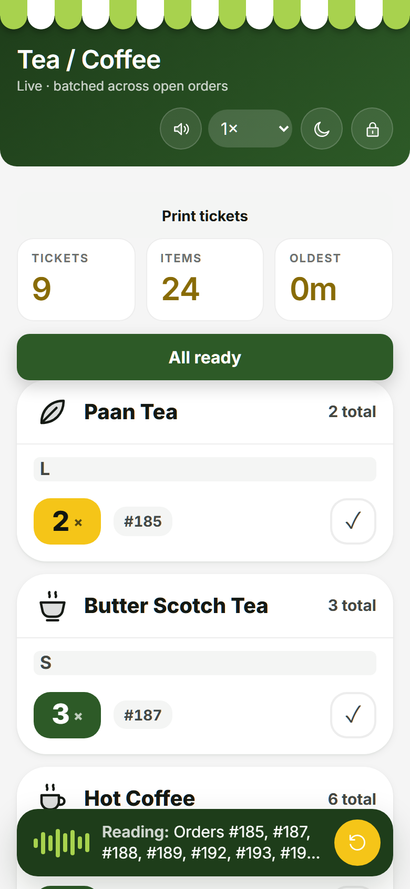
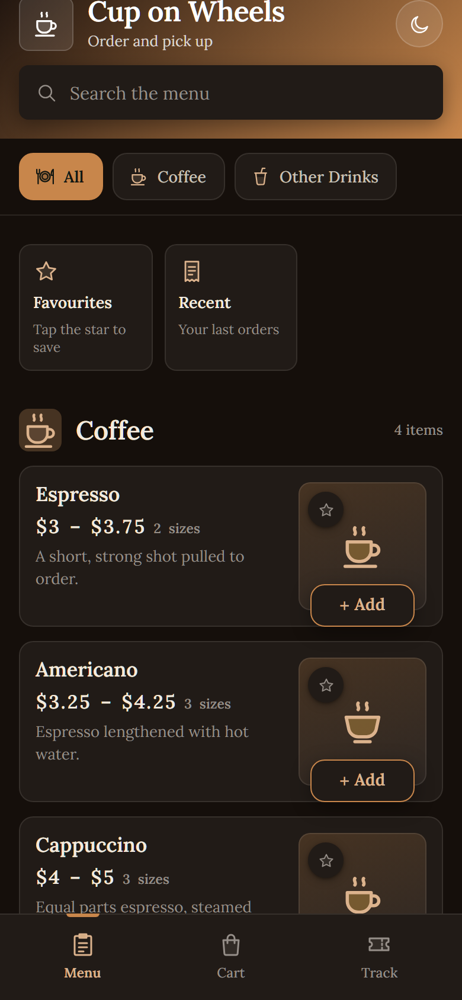
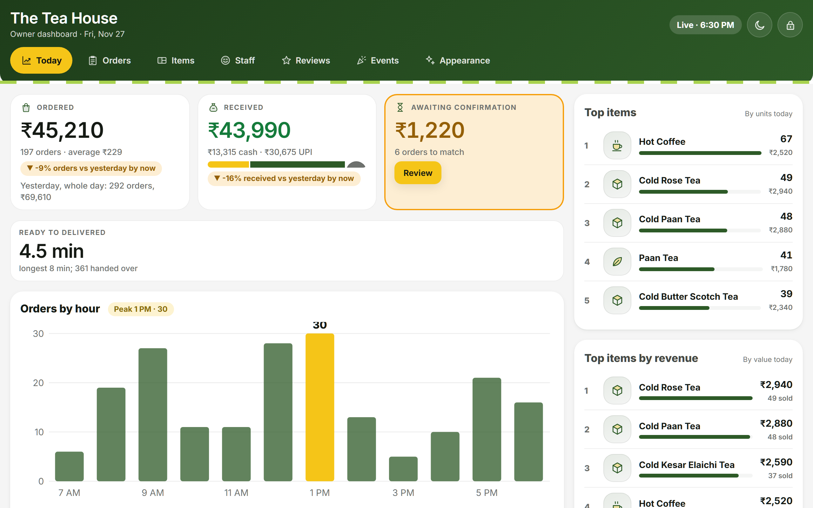
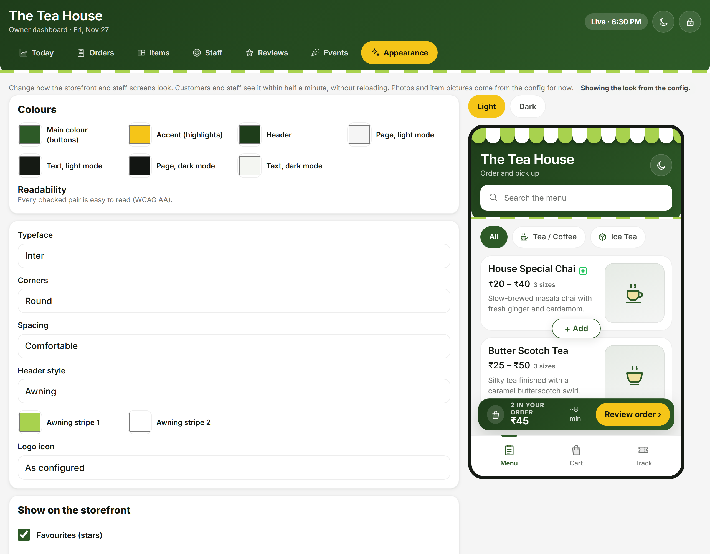
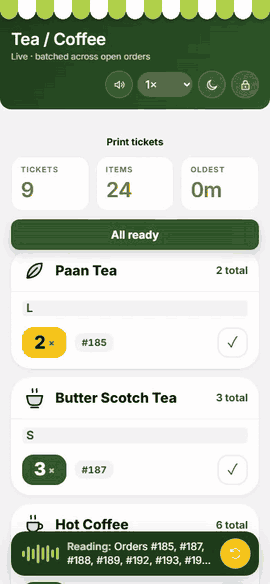

# ibow

[](https://github.com/YoByron/ibow/actions/workflows/ci.yml)

**Intelligent Business Orchestration and Workflows.** Free, open-source (AGPL-3.0), AI-enabled orchestration for any
business: the **front** where customers order on their own phone, the **back** where staff do the work and take the
money, and the **brain** beside the owner that knows the numbers. No hardware to buy, no training for staff. It runs
free on Cloudflare's Workers free plan, or on a US$5 server, or a laptop at the counter.

**[Live demo](https://ibow.saketposwal.com)** (throwaway PINs are shown on its sign-in screens) · **[Showcase](https://ibow.saketposwal.com/showcase)** (a page about ibow; demos serve it at `/showcase`, a real install only with `"showcase": true` in `business.json`) · [Install guide](docs/install.md) · [Configure guide](docs/configure.md)

<table>
  <tr>
    <td align="center"><br><sub>Storefront</sub></td>
    <td align="center"><br><sub>Live token</sub></td>
    <td align="center"><br><sub>Counter</sub></td>
    <td align="center"><br><sub>Station</sub></td>
    <td align="center"><br><sub>A themed sample</sub></td>
  </tr>
</table>
<table>
  <tr>
    <td align="center"><br><sub>Owner dashboard</sub></td>
    <td align="center"><br><sub>Appearance: your look, no code</sub></td>
  </tr>
</table>

The first workflow is the busy counter: a tea stall, a coffee cart, a food truck, a bakery, a service desk. The customer's
phone is the front desk, each prep station gets one batched list read out loud, and the counter only takes money and
calls tokens.

## Quick start: try it on your computer

You need [Node 24](https://nodejs.org) or newer and [git](https://git-scm.com/downloads). On Windows use PowerShell.

```sh
git clone https://github.com/YoByron/ibow ibow
cd ibow
npm ci
npm run demo
```

The demo starts a sample tea house with a week of orders and prints the storefront, staff and owner addresses and PINs
that work only for the demo. Open them in a browser. `Ctrl+C` stops it and deletes its data. Try another business with
`npm run demo -- coffee-cart` (also `food-truck`, `bakery`, `service-desk`). If port 3000 is busy:
`npm run demo -- --port 3001`.

## Deploy it for a business

### On Cloudflare (free plan)

You need a free [Cloudflare account](https://dash.cloudflare.com/sign-up). In the `ibow` folder, after editing the
three files in `config/` for your business ([configure guide](docs/configure.md)):

```sh
npm ci
npx wrangler login
npm run hash-pin
npx wrangler deploy
npx wrangler secret put OWNER_PIN_HASH
```

`hash-pin` asks for the owner's PIN (4 to 12 digits) and prints a hash; paste that hash when the last command asks for
the secret. `wrangler deploy` prints your address (`https://ibow.<you>.workers.dev`): the storefront is `/`, staff use
`/staff`, the owner uses `/owner`. Domain, backups, upgrades and the limits of the free plan are in
[docs/install.md](docs/install.md).

[](https://deploy.workers.cloudflare.com/?url=https://github.com/YoByron/ibow)

The button copies the repository to your own Cloudflare account and deploys the starter business in `config/`; it asks for
`OWNER_PIN_HASH` (make the value with `npm run hash-pin` first). Edit `config/` in your copy and redeploy to make it yours.

### On your own server

Plain Node, a systemd service, Caddy for HTTPS and daily backups on a small VPS, or a laptop on the shop's Wi-Fi: see
[docs/install.md](docs/install.md#b-plain-node-on-a-vps).

### Configure it for your business

A business is three JSON files (who it is, what it sells, which station makes what), plus an optional theme and wording,
and a few settings. [docs/configure.md](docs/configure.md) lists every field and ends with a worked example: turn a sample
into your own café in 15 minutes.

## What it does

- **Front: the customer's own phone.** Scan a QR, browse the catalog, order, pay by UPI QR or at the counter, and
  follow a live token (`26-014`) from received to ready, with sound, vibration and a notification. No app, no account,
  no phone number; a name is optional. The same storefront runs as a self-order screen on a shop tablet.
- **Back: staff phones.** The counter sees new orders, takes walk-ins, confirms cash or UPI (money is never shown as
  received until a person confirms it), serves line by line, calls tokens aloud, and can undo for 5 minutes. Each
  station sees only its own items, totalled across orders ("12 House Special Chai M, 3 Hot Coffee") and spoken as one
  batch, or as one card per job for work like repairs. 80mm tickets print from the browser.
- **Brain: the owner's dashboard.** Today in plain sentences, orders kept apart from money actually received, the
  busiest hour, best sellers, a fair comparison with yesterday, tomorrow's prep forecast, repeat-customer badges,
  reviews, and item switches that take effect at once. All of it is rule-based and works with no AI at all. An opt-in
  analyst answers questions in plain language on the owner's own model key (any OpenAI-compatible provider, or a free
  local model).
- **Config, never code.** A business is JSON files; the look (colours, typeface, header, logo, icons, photos and every
  word) is a theme the owner can change from the Appearance screen. Customer names and review text are cleared after a
  retention period (30 days by default).



## Samples

Five invented businesses in `samples/`, all running on the same code with no changes:

| Sample | Business | Currency, zone | Stations |
|---|---|---|---|
| `tea-house` | A tea and snack counter, 78 items | INR, Kolkata | tea/coffee, kitchen |
| `coffee-cart` | A morning coffee cart | USD, New York | coffee bar |
| `food-truck` | A dinner food truck | INR, Kolkata | grill, fryer, drinks |
| `bakery` | A neighbourhood bakery | INR, Kolkata | packing table |
| `service-desk` | A repair counter, one card per job | AED, Dubai | front desk, workshop |

How it's built: [docs/architecture.md](docs/architecture.md) (layers, contracts, API, field notes) and
[docs/decisions.md](docs/decisions.md) (every choice and its reason). One Hono app on SQLite, run as a Cloudflare Worker
with one Durable Object per install or as a plain Node process; a vanilla TypeScript client of about 40 KB gzipped on
first load, three runtime dependencies.

## Case study

Coming soon. ibow's workflow comes from a counter app that ran live at a real tea-and-snack shop; its real numbers will
be published here once they are ready.

## Roadmap

- **Now:** the first public release, and a pilot rush on the rebuilt app.
- **Shipped:** the customer, counter, station and owner screens, an opt-in AI analyst, themes and Appearance, and
  Cloudflare Workers hosting.
- **Later:** payment methods beyond UPI, regional languages for the staff screens, multiple outlets per install,
  WhatsApp alerts, and other queue workflows (a clinic queue) on the same core.

Progress, milestone by milestone: [docs/plan.md](docs/plan.md).

## Contributing

Issues and pull requests are welcome; see [CONTRIBUTING.md](CONTRIBUTING.md) (`npm run gate` before every commit,
tests first). Report a security problem privately as described in [SECURITY.md](SECURITY.md). Third-party licences:
[THIRD_PARTY_NOTICES.md](THIRD_PARTY_NOTICES.md). Changes: [CHANGELOG.md](CHANGELOG.md).

## No warranty

ibow is provided "as is", without warranty of any kind, express or implied, as sections 15 and 16 of the
[AGPL-3.0](LICENSE) say: no warranty of merchantability, fitness for a particular purpose, and no liability for
damages, all to the extent permitted by applicable law. Use it at your own risk.

Whoever runs ibow for a business is responsible for that business: for its compliance with the law (payments, tax,
data protection and consumer rules where you trade), for handling and reconciling its money, and for its backups.
ibow never moves money itself: it shows a UPI QR for the exact amount and staff confirm what actually arrived. Test it
with your own staff before a real rush, and keep your own records.

## Consultancy and support

ibow is free. Setup help, custom workflows, integrations and support are a paid service from its author. To talk about
your business, message on [LinkedIn](https://www.linkedin.com/in/saket-poswal/) or [Instagram](https://www.instagram.com/sakethposwal/).

## License

[AGPL-3.0-only](LICENSE). Use it, change it, run it for clients. If you offer a modified ibow as a service, publish
your changes.
